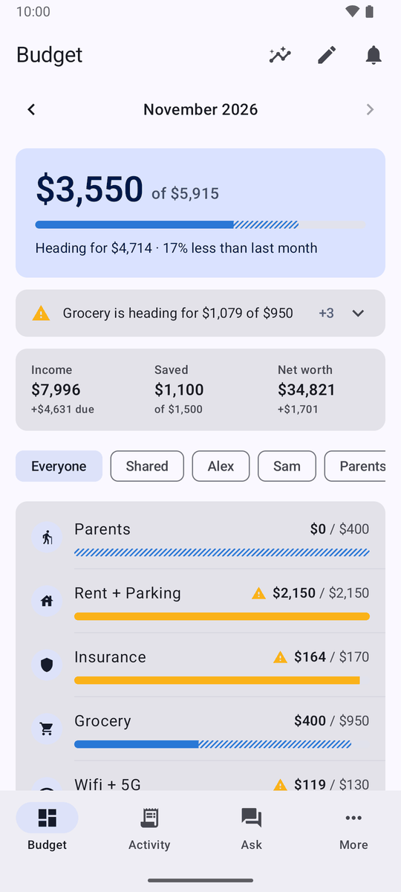
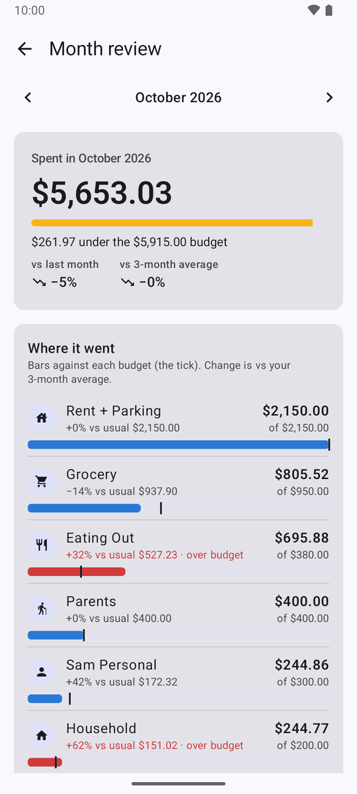
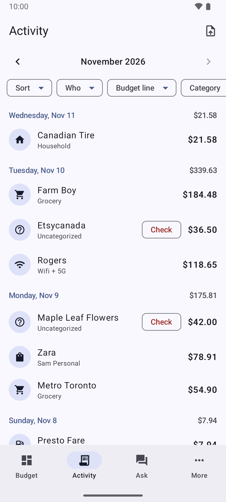
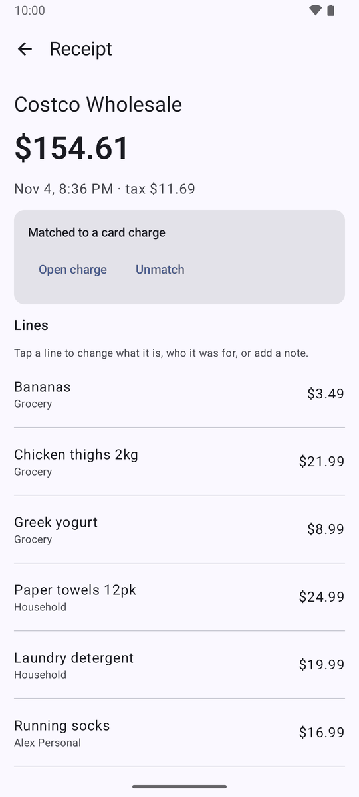
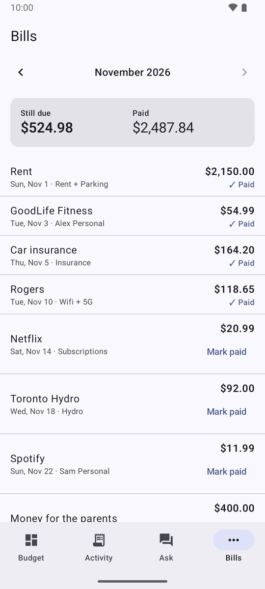
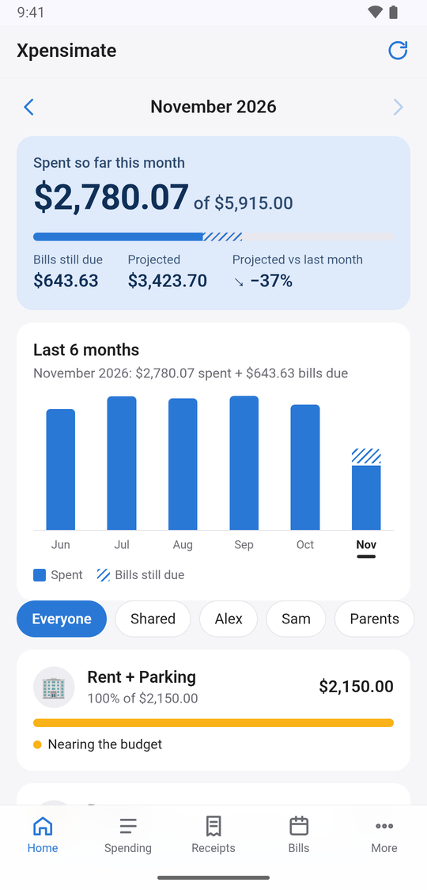
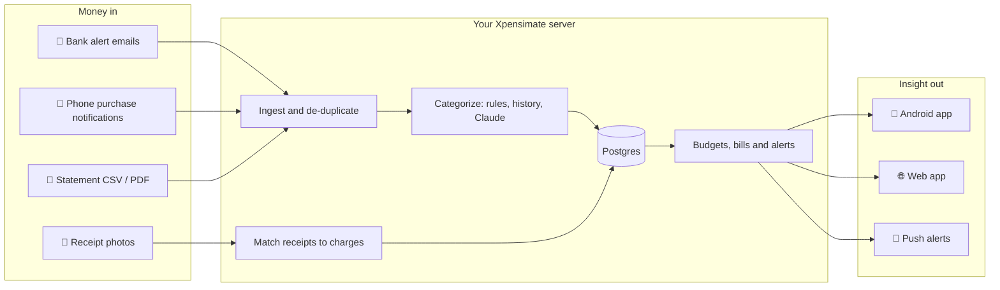

<div align="center">


# Xpensimate

**The self-hosted expense tracker that fills itself in.**

Bank alerts, phone notifications, receipts and statements flow in. Every charge is sorted by *what* it was
and *who* it was for. Budgets, bills and alerts flow out. Your money data never leaves a server you own.

[](https://github.com/samratvij/Xpensimate/actions/workflows/ci.yml)
[](LICENSE)


-d97757)
[](CONTRIBUTING.md)

[Screenshots](#-screenshots) · [Features](#-features) · [How it works](#-how-it-works) · [Quick start](#-quick-start) ·
[Banks](#-supported-banks) · [Under the hood](#-under-the-hood) · [Roadmap](#%EF%B8%8F-roadmap) ·
[Contributing](CONTRIBUTING.md)

</div>

---

## 📸 Screenshots

<div align="center">

| Budget at a glance | Month-end review | Every charge, sorted |
|:---:|:---:|:---:|
|  |  |  |
| **One receipt, many budgets** | **Bills you can see coming** | **Web app for iPhone and laptops** |
|  |  |  |

<sub>Demo data for a fictional household: try it yourself with <code>python -m app.scripts.seed_demo</code>.</sub>

</div>

## 🤔 Why Xpensimate?

Most budgeting apps want your bank password, sell you a subscription, or leave you typing in every coffee.
Xpensimate takes a different route:

- **No bank logins.** It reads the purchase alerts your bank already sends you, and the notifications your
  phone already shows.
- **No data broker.** Everything lives in a Postgres database on your own machine or VPS.
- **No manual entry.** Charges arrive on their own and get categorized; you only fix the odd one, and it
  learns from that.
- **Built for households.** Shared groceries, one person's haircut and money sent to parents are budgeted
  differently, because they *are* different.

## ✨ Features

<table>
<tr>
<td width="50%" valign="top">

### 📨 Automatic capture
Bank alert emails through Gmail, Wealthsimple and Google Wallet purchase notifications on Android, and
month-end statement imports that catch anything missed. A purchase reported by two feeds is stored once.

</td>
<td width="50%" valign="top">

### 🏷️ What + who
Every charge gets a **category** (Grocery, Eating Out, …) and a **purpose** (Shared, Alex, Sam, Parents…).
Rules, history and Claude fill them in; your corrections are never overwritten.

</td>
</tr>
<tr>
<td valign="top">

### 🧾 Receipts, line by line
Snap a photo and Claude reads every line. The receipt is matched to its card charge, so one Costco run
can count as groceries, household supplies and one person's shopping at the same time.

</td>
<td valign="top">

### 🎯 Budgets with alerts
Monthly budgets per line, with a push notification at 80% and another when it's exceeded. Shared spending
is budgeted by category, personal spending per person.

</td>
</tr>
<tr>
<td valign="top">

### 📅 Bills you can see coming
Recurring bills are detected from your history or added by hand, tracked as paid, upcoming or overdue,
and folded into a projected month-end total.

</td>
<td valign="top">

### 📱 Two apps, one server
A native Android app and a web app that feels at home on an iPhone's home screen. Each person has their
own token, so every edit shows who made it.

</td>
</tr>
<tr>
<td valign="top">

### 🔍 Month-end review
Where the money went against each budget, how it compares with your usual month, top merchants, and
trends over the last six months.

</td>
<td valign="top">

### 🔒 Private by design
Self-hosted, read-only Gmail access, outbound-only push, a home-server setup with nothing exposed to the
internet, and a tiny footprint (it runs happily in 1 GB of RAM). Use Claude, or run an open model on your
own server so nothing leaves it.

</td>
</tr>
</table>

## 🧭 How it works



### What + who = the budget line

Two questions decide where a charge is budgeted. You name the people in the setup wizard (or later under
More → Household); the apps pick them up from the server right away.

| Charge | What (category) | Who (purpose) | Budget line |
|---|---|---|---|
| Weekly groceries | Grocery | Shared | **Grocery** |
| Alex's haircut | Personal Care | Alex | **Alex Personal** |
| Money sent to parents | Transfer | Parents | **Parents** |
| Shoes bought for parents | Shopping | Parents | **Parents Shopping** |

## 🚀 Quick start

> **You'll need:** a machine with Docker (a spare PC at home or a small VPS), an Android phone or any
> browser, and optionally an AI model for automatic categorization and receipt reading: an
> [Anthropic API key](https://console.anthropic.com/), or an open model on your own server
> ([docs/local-models.md](docs/local-models.md)).

**1. Get the code and set your secrets**

```bash
git clone https://github.com/samratvij/Xpensimate.git
cd Xpensimate/backend
cp .env.example .env                       # passwords and tokens: openssl rand -hex 32
```

**2. Start the server**, choosing where it lives:

| | 🏠 Home server + Tailscale | ☁️ VPS |
|---|---|---|
| Reachable from | your own devices only | the internet (token-protected) |
| HTTPS | `tailscale serve` | Caddy, automatic Let's Encrypt |
| Start with | `docker compose up -d --build` | `docker compose -f docker-compose.yml -f compose.vps.yml up -d --build` |

Step-by-step for both: **[docs/hosting.md](docs/hosting.md)**.

**3. Set up your household**: open `https://<your-server>/app/` and sign in with your token. A short wizard
asks your currency, who spending is for, which categories you want, and which cards you use; change it any time under
More → Household.

**4. Connect your phone**

- **Android:** build the app from `android/` ([below](#-the-apps)), then enter your server address and token.
- **iPhone:** add the web app to your home screen (Share → Add to Home Screen).

**Just want to look around?** Skip the wizard: use the example household, then fill it with six months of
made-up spending (it refuses to run once you have real transactions):

```bash
cp household.example.toml household.toml && docker compose restart api
docker compose exec api python -m app.scripts.seed_demo
```

**5. Bring your history** (optional): More → Import past spending takes a CSV from a spreadsheet or another
app, learns how you categorize, and can add your older spending.

**6. Optional extras**

- 🦙 [A local model instead of Claude](docs/local-models.md): `-f compose.ollama.yml` runs Ollama alongside
- 📧 [Bank alert emails via Gmail](docs/gmail-setup.md)
- 🔔 [Push notifications for budget alerts](docs/firebase-setup.md)

## 🏦 Supported banks

Bank support is Canadian today. Adding yours is usually one small parser module plus a test:
**[CONTRIBUTING.md](CONTRIBUTING.md)** shows how.

| Bank | Alert emails | Phone notifications | Statement import |
|---|:---:|:---:|:---:|
| Tangerine | ✅ | | ✅ CSV |
| PC Financial | ✅ | | ✅ CSV |
| RBC Royal Bank | ✅ | | ✅ PDF |
| Canadian Tire (Triangle) | 🧪 | | ✅ CSV |
| Wealthsimple | | ✅ | ✅ CSV |
| Google Wallet (any card) | | ✅ | |

🧪 = written to the expected format, not yet confirmed against a real alert.

## 📱 The apps

<details>
<summary><b>Android app</b>: build and install</summary>

<br>

Open `android/` in Android Studio, or build from the command line with JDK 17:

```bash
cd android && ./gradlew assembleDebug
# app/build/outputs/apk/debug/app-debug.apk
```

On first launch, enter your server address and your API token.

- **Purchase capture** needs "notification access" for Xpensimate (Settings in the app links to it).
  Purchases seen while the server is unreachable are queued and sent later.
- **Push alerts** need `app/google-services.json` from your own Firebase project
  ([docs/firebase-setup.md](docs/firebase-setup.md)). Without it the app works, minus push.

</details>

<details>
<summary><b>Web app</b>: iPhone, iPad and laptops</summary>

<br>

The server serves a full web app at `/app/`: dashboard, activity, transaction edits and splits, receipt
uploads, bills, budgets, month review, alerts and categories. Plain HTML and JavaScript, no build step.
On an iPhone, open it in Safari and use **Share → Add to Home Screen**. Browsers need HTTPS: on a home
server, `tailscale serve` provides it ([docs/hosting.md](docs/hosting.md)).

</details>

## 🔧 Under the hood

<details>
<summary><b>🏷️ Categorization pipeline</b></summary>

<br>

Each incoming transaction gets a category and a purpose from, in order:

1. **Rules** (`/api/v1/rules`): whole-word merchant patterns, optionally limited to an account, weekdays or
   local hours. Rules saved with `"remember": true` beat the generic starter rules for Canadian merchants.
2. **History**: the last confident (or manually set) categorization of the same merchant.
3. **The AI model** (`CATEGORIZER_MODEL`, default `claude-haiku-5-5`, structured output), given your
   household description, purposes, and past choices and notes for that merchant. Claude needs
   `ANTHROPIC_API_KEY`; with `LLM_PROVIDER=openai` it's any OpenAI-compatible server such as Ollama
   ([docs/local-models.md](docs/local-models.md)). With neither, the transaction stays `Uncategorized`
   until you set it.

Manual changes are never overwritten. `POST /api/v1/transactions/recategorize` re-runs the pipeline on
uncategorized rows (e.g. after adding a key or rules).

</details>

<details>
<summary><b>🧾 Receipts and matching</b></summary>

<br>

`POST /api/v1/receipts/ocr` takes a receipt photo (JPEG/PNG/WebP up to 15 MB). The image is rotated per
EXIF, capped at 2000 px and stored under `backend/data/receipts/`; the AI model (`RECEIPT_MODEL`, default
`claude-sonnet-5-5`, or a local vision model) reads it into merchant, date and time, tax, total and line items, each with a category
and purpose. Receipts that don't add up (±$0.05) or have no readable date come back with
`needs_review: true`.

Receipts are matched to card charges automatically, whichever arrives first: within 72 hours and $0.05, or
for restaurants a card amount up to 30% higher (the tip) with a similar merchant name. Ties are left for you
to pick. A match copies the lines onto the charge, spreading tax and tip, so each line counts under its own
budget line.

</details>

<details>
<summary><b>🎯 Budgets and alerts</b></summary>

<br>

Budgets are set per budget line (`PUT /api/v1/budgets/{line}`). After any change in spending, the affected
lines are re-totalled for the current month: at the warning threshold (80% by default) a WARNING alert
fires, over the limit an EXCEEDED alert, each at most once per line per month. Alerts are stored
(`GET /api/v1/alerts`) and pushed to registered phones through Firebase Cloud Messaging.

</details>

<details>
<summary><b>📅 Recurring bills</b></summary>

<br>

Bills and memberships (`/api/v1/recurring`) have a cadence (weekly, every two weeks, monthly), a usual amount
and a category and purpose. `POST /recurring/detect` finds steady series in past transactions. A charge
whose merchant and amount fit is linked as the payment; payments made outside your cards (rent by
e-transfer) are recorded with `POST /recurring/{id}/paid`. The summary adds `expected` and `projected`
(spent + expected) per budget line.

</details>

<details>
<summary><b>🗂️ Importing past spending</b></summary>

<br>

More → Import past spending takes a CSV from a budgeting spreadsheet or another app. Xpensimate guesses
which column is the date, merchant, amount, category, who and note (and the date format and sign), and how
your category and "who" names map onto its own; you check and adjust. Then every row teaches it: Claude sees
how you filed each merchant, merchants you always filed the same way become rules, and a charge that turns
out to be one of the imported purchases takes its category. Rows dated before the first charge Xpensimate
already has can also be added as spending, so trends and reviews go back further; later rows only teach,
so nothing is counted twice. Importing again replaces the previous import, and it can be removed entirely.

</details>

<details>
<summary><b>📄 Statement import</b></summary>

<br>

Upload a statement at `<server>/import` or from the Android app. The format is detected from its header.
The preview compares every row with what the app already has (same amount, within 3 days): known charges
are confirmed, missing ones added and categorized, card payments recorded as not an expense, and ties left
for you. It also lists app charges the statement doesn't have. Nothing changes until you import, and
importing the same file twice adds nothing.

</details>

<details>
<summary><b>🧱 Stack and project layout</b></summary>

<br>

| Part | Tech |
|---|---|
| API | Python 3.11, FastAPI, SQLAlchemy, Alembic |
| Database | Postgres 16 |
| AI | Claude (Haiku to categorize, Sonnet to read receipts), or any OpenAI-compatible server (Ollama, llama.cpp, vLLM) |
| Android | Kotlin, Jetpack Compose, Retrofit, ML Kit document scanner, Firebase Cloud Messaging |
| Web app | Plain HTML, CSS and JavaScript |
| Deploy | Docker Compose; Tailscale or Caddy for HTTPS |

```
backend/
  app/api/v1/        REST endpoints
  app/daemons/       Gmail worker and bank alert parsers
  app/services/      categorizer, receipts, reconciler, budgets, recurring bills
  app/statements/    statement CSV/PDF parsers
  app/web/           the web app and the statement import page
  household.example.toml
android/             the Android app
docs/                hosting, Gmail, Firebase, architecture
```

The API is documented interactively at `<server>/docs`. Every `/api/v1/*` call needs
`Authorization: Bearer <token>`.

</details>

<details>
<summary><b>🧪 Development</b></summary>

<br>

```bash
cd backend
docker compose run --rm api pytest -q        # tests, against a separate expense_test database
docker compose run --rm api alembic revision --autogenerate -m "describe change"   # after model changes
```

Tests use a fictional household (`backend/tests/household.toml`). CI runs the backend tests and the
Android build on every push.

</details>

More on the design choices: **[docs/architecture.md](docs/architecture.md)**.

## 🔒 Privacy and security

- Your data lives in your own Postgres database. The only thing that leaves it is what Claude needs, and
  only if you add an API key: merchant names, amounts and notes for categorizing, and receipt photos for
  reading. With a local model, nothing leaves your server at all.
- Gmail access is read-only, and only alert emails from known bank senders are parsed; statements, offers
  and one-time codes are ignored and never stored.
- On a home server the API listens only on your Tailscale network. On a VPS it sits behind Caddy with HTTPS.
- Backups (`backend/scripts/backup.sh`) are a cron line away; see [docs/hosting.md](docs/hosting.md).

## 🗺️ Roadmap

- [x] Bank alerts, phone notifications, statement import
- [x] Receipt reading and line-level matching
- [x] Budgets, push alerts, recurring bills, month review
- [x] Home-server and VPS hosting guides
- [x] Screenshots and a demo dataset
- [x] First-run setup wizard in the web app (no editing `household.toml` by hand)
- [x] History import from any spreadsheet or CSV
- [x] Categories in the setup wizard
- [x] Local open models (Ollama or any OpenAI-compatible server) instead of Claude
- [ ] Banks beyond Canada (contributions very welcome)
- [ ] Optional encrypted off-site backups

## 🤝 Contributing

Bug reports, ideas and pull requests are welcome. The most valuable contribution is support for your bank:
see **[CONTRIBUTING.md](CONTRIBUTING.md)**.

## 📜 License

[MIT](LICENSE). Use it, change it, share it.
